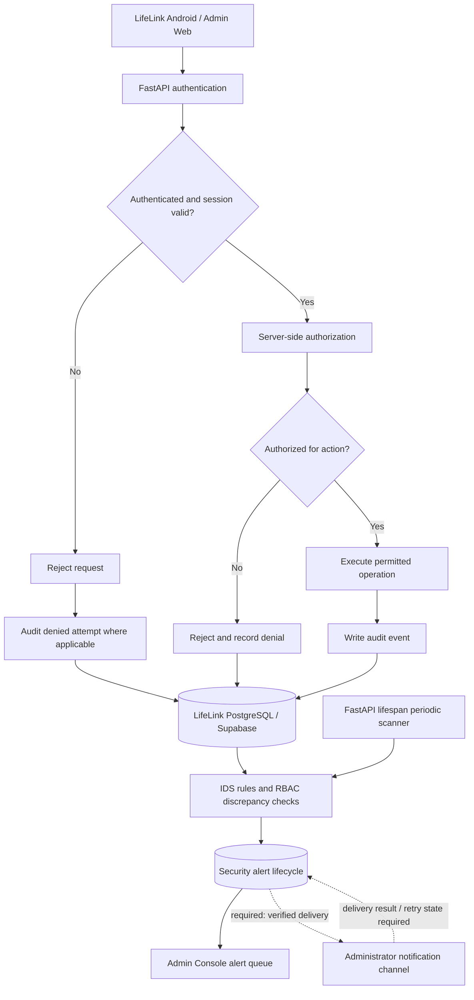
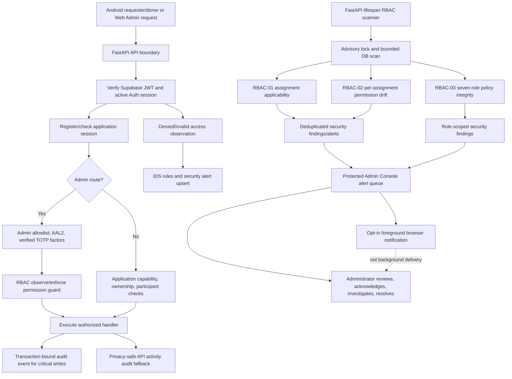

# LifeLink IDS/IPS completion audit

**Review date:** 2026-11-27  
**Base:** `main` at the time of review  
**Purpose:** Compare the existing LifeLink implementation with the project IDS/IPS criteria and define the smallest safe completion sequence.  
**Scope:** FastAPI PostgreSQL backend, SQL migrations, RBAC/security documentation, and read-only Supabase schema/data inspection. Android Retrofit feature-to-endpoint groups were inventoried; this is not a complete screen-by-screen UI action trace or manual workflow validation.  
**Safety:** No production data, grants, policies, Auth settings, migrations, or deployments were changed.

## Executive finding

LifeLink already has a substantial IDS/IPS foundation. This is a completion and integration effort, not a greenfield implementation.

Existing components include:

- Audit-event storage with the required IDS/IPS fields.
- A shared audit writer and authenticated personal audit-history endpoint.
- An application session registry, Supabase-session validation, and administrator session-revocation controls.
- Security-alert storage, deduplication, severity/status lifecycle, and admin read/update endpoints.
- Three narrow active admin intrusion rules: IDS-03, IDS-04, and IDS-05.
- A role/permission registry, least-privilege seed mappings, role-applicability checks, assignment-scoped RBAC-01/RBAC-02 checks, and role-scoped RBAC-03 policy integrity findings.
- Admin UI/API surfaces for viewing alerts, sessions, audit records, users, and role assignments.

The largest remaining gaps are rollout and evidence: live administrator-role assignments are still absent; production runtime scanner/MFA verification is outstanding; background administrator notification delivery is not implemented; audit coverage and Android/web screen-to-route tracing still need evidence; and manual end-to-end acceptance has not been completed.

## Criteria-to-implementation matrix

| Criteria | Existing implementation | Status | Required completion |
|---|---|---|---|
| IDS/IPS linked to the same application database | FastAPI uses the LifeLink PostgreSQL/Supabase database; IDS/IPS tables are in that database | Foundation present | Verify Android actions reach the same backend/database and document the end-to-end path |
| Identify all users | Admin user-list endpoint exists | Partial | Prove complete user inventory, pagination/total count, account-state coverage, and role/capability joins |
| Identify roles and permissions per user | Seven role definitions, 19 permissions, 19 role-permission mappings; role-read and user-role APIs exist | Partial | Reconcile legacy profile capabilities/admin allowlists with the new RBAC registry; provision assignments through a controlled process |
| Record user sessions | `lifelink_user_sessions`, authenticated-session validation, session inventory/revocation | Partial | Clearly label this as observed application sessions; reconcile Auth session lifecycle and test all clients |
| Record ADD/EDIT/DELETE operations | Audit schema and action normalization exist; numerous sensitive writes have atomic audit events | Partial | Finish remaining mutation coverage, confirm classification and actor attribution, and test all client-triggered mutations |
| Provide IDS/IPS flowchart | Not verified in the reviewed implementation/docs | Missing evidence | Add a flowchart matching actual event collection, validation, detection, prevention, alerting, and resolution |
| Seven required log fields | `session_id`, `log_id`, `actions`, `description`, `ip_address`, `timestamp`, `device_used` exist in the audit envelope | Implemented in schema | Validate populated/non-null behavior where applicable, safe device/IP attribution, and display/export |
| Every applicable action logged | Authenticated API middleware plus explicit transaction-bound events for sensitive operations | Partial | Route-by-route and client-to-route verification; close legacy/uncovered operations |
| Individual logs per user | `GET /v1/audit/me` filters by verified token subject | Implemented in API | Verify UI access and cross-account isolation with multiple real test users |
| Detect inappropriate role/permission assignments | Write-time applicability validation, periodic RBAC-02 assignment checks, and RBAC-03 role-level policy checks for all seven registered roles; four administrative matrices plus explicit zero-admin-grant policies for requester, donor, and super_admin | Partial | Reconcile legacy role sources and live assignments; verify alert notification delivery |
| Warn and notify administrator | Alert records and admin alert queue/lifecycle exist | Partial | Prove an actual administrator notification channel, delivery/retry state, unread indication, and end-to-end delivery |

## Existing repository implementation

### Database migrations

The repository includes:

- `005_audit_events.sql`
- `017_ids_ips_audit_foundation.sql`
- `018_user_session_registry.sql`
- `019_security_alerts.sql`
- `020_rbac_role_permission_registry.sql`
- `021_role_policy_integrity_findings.sql`

Migration 020 creates:

- `lifelink_roles`
- `lifelink_permissions`
- `lifelink_user_roles`
- `lifelink_role_permissions`

It seeds seven role definitions and 19 permission definitions. The initial migration deliberately does not grant elevated roles to accounts.

### Audit and user activity

- `GET /v1/audit/me` derives the actor from the verified Supabase token; a caller cannot request another user's history by supplying an actor ID.
- Admin audit endpoints expose audit records without providing API routes to edit/delete them.
- The audit schema includes the seven criteria fields and legacy-compatible fields.
- The existing audit coverage review records transaction-bound audit work for profile updates, emergency-request creation, contact lifecycle, donor profile operations, donor presence, exact-location disclosure, messages, saved messages, map visibility, contact sharing, and moderation.
- The same review identifies remaining legacy and lower-priority candidates, including legacy donor presence/availability and push-token registration. These must be reconciled against current source before marking complete.
- Exact-location reads are treated as sensitive disclosure events; coordinates are excluded from audit metadata.
- General API-boundary logging is a fallback, not a substitute for atomic audit writes on critical mutations.

Reference: `docs/SECURITY_AUDIT_COVERAGE_REVIEW_2026-11-22.md`.

### Sessions

- Supabase JWTs are verified by the backend.
- `get_active_postgres_principal` checks the supplied session ID against `auth.sessions` and registers the observed session in `lifelink_user_sessions`.
- Protected application API requests check session validity and the application registry.
- Administrators can inspect and revoke observed application sessions.
- Session revocation is an application-side control. Do not describe it as revoking Supabase refresh tokens unless a separate Auth revocation operation is implemented and tested.
- A session only appears in the application registry after it has been observed by the API; it is not automatically a complete inventory of all Auth sessions.

### Intrusion detection and alert lifecycle

Confirmed narrow rules:

- IDS-03: repeated unauthorized administrator access; threshold is five attempts within ten minutes.
- IDS-04: missing administrator session context.
- IDS-05: reuse of a revoked administrator session.

The security-alert API is read-only; detection is performed by an independent periodic RBAC scan started from the FastAPI lifespan (default 300 seconds, configurable with a 60-second minimum). A PostgreSQL transaction-scoped advisory lock prevents overlapping scans across API instances; each scan transaction has a 15-second statement timeout. The continuation implementation now persists scanner success/failure metadata and exposes it through a protected Admin Console endpoint. Execution in a deployed instance remains unverified; host sleep/restarts can interrupt the in-process task.

The alert table supports open, acknowledged, investigating, resolved, and false-positive states. The API can update alert state and deduplicate active incidents.

**Delivery boundary:** the web Admin Console now offers opt-in browser notifications while an authenticated console remains open. This is foreground, browser-permission-based polling; it does not work after sign-out, tab closure, or browser shutdown. Background push/email delivery, durable per-recipient delivery attempts, retries, and end-to-end provider delivery remain unimplemented and unverified. A row in `lifelink_security_alerts` is not proof that an administrator was notified.

### RBAC and authorization

The RBAC registry has seven roles and 19 permissions. The connected Supabase project currently contains 19 role-permission mappings.

The read-only live database inspection returned:

| Registry | Live rows |
|---|---:|
| Roles | 7 |
| Permissions | 19 |
| Role-permission mappings | 19 |
| User-role assignments | 0 |
| Security alerts | 0 |
| Observed sessions | 23 |

The zero user-role assignment count is significant: the registry currently has no assigned users, even though the legacy server-side administrator allowlist and existing profile capabilities continue to govern application access.

Operational admin routes now declare permission-specific guards while retaining the existing allowlist, active-session, AAL2, and two-verified-TOTP identity gate. `LIFELINK_RBAC_ENFORCEMENT_MODE` defaults to `observe`, preserving access while the live registry has zero user-role assignments; `enforce` checks the exact active permission grant and denies missing grants. Role assignment remains separately protected by the RBAC-manager allowlist and applicability checks. The permission registry is not yet the universal effective authorization source until real administrator assignments are provisioned and enforcement is explicitly enabled.

## Highest-priority updates

### P0 — Make authorization enforceable

1. Define one server-side permission dependency that reads effective, non-expired RBAC assignments and role-permission mappings.
2. Map every admin endpoint to a permission key:
   - dashboard: `dashboard.read`
   - user listing: `users.read`
   - user capability changes: `users.update`
   - alert reads: `security.alerts.read`
   - alert lifecycle updates: `security.alerts.manage`
   - session listing: `security.sessions.read`
   - session revocation: `security.sessions.revoke`
   - audit/error reads: `audit.read` (or a separately defined permission if error-log access must be narrower)
   - role registry/user-role reads: `roles.read`
   - role assignment: `roles.assign` plus the existing manager safeguard
3. Preserve a secure bootstrap path so the first trusted security/RBAC administrators can be provisioned out of band. Never infer elevated access from public signup or client-editable profile metadata.
4. Fail closed when the registry is unavailable or a permission is absent.
5. Add tests proving each role can perform only its intended endpoints and that expired assignments confer no access.

### P0 — Complete role reconciliation and discrepancy detection

1. Define how the legacy admin allowlist and profile capability fields map to the RBAC registry.
2. Provision initial assignments through an explicitly approved, audited, out-of-band process.
3. Detect missing, expired, unexpected, and conflicting assignments.
4. The periodic FastAPI-lifespan scanner checks active user-role assignments and all seven explicit role policies. Four administrative roles have exact least-privilege permission matrices; requester, donor, and super_admin explicitly have no grants from the administrative permission namespace. Requester/donor application authorization remains governed by existing capability, ownership, and participant checks; super_admin uses the separate dual allowlist. RBAC-03 works even when no users are assigned and stores findings in a dedicated role-target table. Persisted scanner-health visibility is implemented in migration 022, startup schema setup, a protected Admin API endpoint, and the web Security alerts panel. Deployed runtime operation and full lifespan start/stop behavior remain to be verified.
5. Keep invalid assignments blocked at write time and detected if introduced through an out-of-band path.

### P0 — Prove administrator notifications

1. Identify the existing notification provider and supported channels already configured for LifeLink.
2. Define which severities/events require immediate notification.
3. Add delivery state, retry/backoff, deduplication, and failure visibility.
4. Add an unread security-alert indicator in the admin console.
5. Test an induced RBAC discrepancy from detection through actual delivery and acknowledgement.

Do not introduce a paid provider or new external service without approval.

### P1 — Finish audit coverage

1. Reconcile all current FastAPI routes with the existing audit coverage document.
2. Trace Android UI actions to API routes so that the criteria's "every action" requirement is interpreted as every applicable security-relevant action, not indiscriminate logging of every screen render.
3. Close remaining high-impact gaps, including legacy donor mutation routes. Push-token registration is now explicitly audited without recording the token; a token-removal endpoint is not currently present and should be added only if the product supports explicit device unlinking.
4. Decide whether donor response, location reads, and other sensitive read operations require explicit access events.
5. Keep critical mutation and audit insertion in one database transaction.
6. Do not log tokens, message content, contact values, blood type, precise GPS coordinates, or raw request payloads.
7. Add tests for action normalization, event attribution, metadata privacy, idempotency, and rollback.

### P1 — Session and device/IP quality

1. Define "device_used": sanitized user-agent/device class rather than a raw or client-asserted device identity.
2. Define trusted-proxy configuration before using forwarded IP headers. The current server peer address can be the proxy address.
3. Define retention and cleanup for audit/session data.
4. Verify sign-out, refresh, expired Auth session, administrator revocation, and cross-client behavior.
5. Make clear that observed sessions are not necessarily every Supabase Auth session.

### P2 — Admin console and academic evidence

1. Show users with legacy capabilities, effective RBAC roles, permissions, and assignment expiry together.
2. Show each user's own audit history and session history under access controls.
3. Show alert severity, rule, correlation, occurrence count, first/last seen, status, and notification delivery state.
4. Add the requested IDS/IPS flowchart and role/permission matrix.
5. Prepare a criteria-based manual test record with screenshots/log IDs and expected/actual outcomes.

## Route and operation inventory to finish

The PostgreSQL API route inventory includes:

- Account/profile: profile read/update and push-token registration.
- Emergency requests: create, contact, contact listing/status, report/block, manual broadcast, history/detail, cancel, fulfill.
- Donor profile: create/update/read, presence, availability, delete.
- Donor operations: legacy donor read/update/presence/availability, inbox, response, map, visibility.
- Location sharing: grant, revoke, exact-location read.
- Conversations: list, message list/send, saved-message list/add/remove, contact-share list/create, report/block.
- Admin: dashboard, user listing/update, alert list/update, session list/revoke, audit/errors, roles, user-role read/assignment.
- Personal audit: own activity history.

For each mutating or sensitive-read route, the next implementation pass must record: Android/web entry point, HTTP route, authenticated actor source, authorization rule, audit event, required seven fields, transaction boundary, detection rule, prevention response, and notification behavior.

## Live-database inspection notes

Read-only SQL inspection on 2026-11-27 confirmed the seven public IDS/RBAC tables exist and reported the row counts above. The inspected tables had RLS enabled. Client roles do not receive direct access to these backend-only registries; the API uses its backend database identity.

This inspection did not read user-identifying audit evidence, modify records, change grants, or apply migrations.

## Acceptance gate

Do not declare IDS/IPS complete until all of the following are demonstrated:

- Every required criterion has a mapped implementation and a passing evidence item.
- Every admin endpoint enforces its mapped permission server-side.
- RBAC assignments are reconciled with the existing LifeLink identity/capability model.
- RBAC discrepancy detection runs independently of a dashboard read.
- An actual administrator notification is delivered and its outcome recorded.
- All required audit fields are populated with trustworthy, privacy-safe values.
- Each user's audit history is isolated from other users.
- High-impact operations and their audit events commit or roll back together.
- Session revocation and expiry are enforced on protected application routes.
- Android and web workflows have been traced and manually validated.
- The flowchart, role/permission matrix, and criteria test evidence are complete.

No production migration, permission grant, role assignment, deployment, or merge is authorized by this audit.

## Android client-to-backend trace

The Android Retrofit interface at `LifeLinkAndroid/app/src/main/java/com/lifelink/app/data/remote/LifeLinkApi.kt` calls the same PostgreSQL API for the following groups:

| Android feature/API group | Backend route families | Audit/security follow-up |
|---|---|---|
| Admin (web-only) | `/v1/admin/me`, dashboard, users, user update, audit, errors, alerts, sessions, roles, scanner health | Android no longer exposes administrator screens or admin API contracts; enforce permissions on every server route regardless of client |
| Account | profile read/update, push-token registration | Profile and push-token registration now have explicit audit paths; push-token add/update records actor/session/correlation only and never the token. No token-removal route was found. |
| Requester | emergency request create/detail/history/cancel/fulfill, contact selected donors, contact status/report/block, manual broadcast | Retain atomic request/contact events; confirm all failed/denied operations are safely observable |
| Donor | donor profile create/read/update, presence, availability, delete, map, visibility, inbox, response | Reconcile legacy donor routes with newer donor-profile routes; ensure response and legacy availability/presence are audited |
| Location sharing | activate/revoke share, matched donor exact-location read, open conversation | Preserve atomic grant/revoke and exact-location disclosure audit; never include coordinates |
| Messaging | conversation list/messages, send, saved-message add/remove, contact-share list/create, report/block | Preserve content-free message/bookmark/contact-share audit and moderation audit; never store message bodies, attachments, or disclosed contact values |

This is an interface-level trace, not proof that every UI action has been manually exercised. The remaining client verification must map each screen/view-model action to the Retrofit method and confirm the authenticated user ID, expected server authorization, audit event, and user-visible result. The app's push-token registration endpoint is present in the interface; no corresponding alert-delivery linkage was found in the security-alert implementation search.

## 2026-11-27 implementation-readiness follow-up

### Authorization route inventory and safe transition

A second source inspection of `lifelink_fastapi/app/admin_api.py`, `app/security.py`, migration 020, and `tests/test_admin_api.py` confirms:

- The admin router's existing handlers consistently depend on `require_admin`; the permission registry is not yet used as a per-route authorization dependency.
- `require_admin` verifies the subject against the private `LIFELINK_ADMIN_USER_IDS` allowlist, requires verified-email policy, requires session context, and rejects sessions marked revoked in the application session registry.
- Role assignment is separately gated by `LIFELINK_RBAC_MANAGER_USER_IDS`; this must remain a distinct privilege from ordinary administrator access.
- The current tests cover allowlist denial, session requirements/revocation, role-manager separation, role applicability, and selected admin HTTP boundaries. They do not yet prove per-permission access for every admin route.
- The live registry's zero assignment count means a strict registry-only rollout would deny all current admins until a controlled assignment process is completed.

The route-to-permission mapping in the P0 list above is the intended first-pass policy. The implementation should use a dependency factory or equivalent centralized policy function, not scattered inline role checks. For a backward-compatible transition:

1. Keep `require_admin` as the authentication and legacy bootstrap gate.
2. For an allowlisted administrator with no RBAC assignment rows, retain legacy access temporarily and emit a measurable legacy-fallback audit event (without recording secrets).
3. If any RBAC assignment exists for that subject, require an active assignment and the exact permission for the route. An expired or incomplete assignment must not silently fall back to the broad allowlist.
4. If RBAC tables cannot be queried, deny permission-sensitive operations with a controlled 503/authorization failure; do not silently grant legacy access during a database failure.
5. Preserve the separate RBAC-manager allowlist for role assignment and permission-policy administration. Do not let `super_admin` self-assign or bootstrap itself.
6. Before removing legacy fallback, reconcile every currently allowlisted admin with an approved, audited RBAC assignment and verify at least two independently controlled managers.

This fallback is a migration bridge, not the target security posture. It must have an explicit removal condition and should be time-bounded operationally.

### Important permission-seed discrepancy to resolve before activation

Migration 020 seeds 19 permission definitions but its visible role-permission seed statements only populate mappings for `operations_admin`, `user_admin`, `security_admin`, and `auditor`. It does not seed mappings for `super_admin`, and it does not map `roles.assign` to a role. The live database count of 19 mappings is consistent with the four least-privilege role groups, not proof that every permission has an intended grant.

The seven-role policy review is now implemented in the branch: requester, donor, and super_admin have explicit zero grants from the administrative permission namespace; four administrative roles retain exact least-privilege matrices. Before enforcement, provision approved user-role assignments out of band and validate the matrices in non-production. Do not infer wildcard super-admin grants.

### Independent detector deployment finding

The checked-in `lifelink_fastapi/render.yaml` declares one Docker web service and no separate Render cron/background worker. The RBAC scanner is launched as an independent asyncio task from the FastAPI lifespan, not from an admin page read, and uses a PostgreSQL advisory lock plus a 15-second statement timeout. Persisted last-run/success/failure health is now available to the Admin Console. This remains an in-process task: it can stop during host sleep, restart, or instance shutdown, and it does not provide a separate always-on worker guarantee. Explicit query batching and deployed runtime verification remain outstanding. Do not add a paid service or assume a separate scheduler exists.

### Notification provider finding

The same Render configuration declares `FIREBASE_SERVICE_ACCOUNT_JSON` as a private environment variable. This is evidence that a Firebase credential is expected by the service, not proof that IDS/IPS alerts are connected to FCM or that a notification has been delivered. Trace the existing push-token storage, Firebase sender, recipient eligibility, and retry/error handling before extending it. Any alert notification implementation must target only authorized administrators, avoid exposing sensitive evidence in notification payloads, deduplicate by alert/event, and record delivery outcomes without logging credentials or device tokens.

### Implementation gate for the next code change

Do not make a permission-enforcement code change until the permission matrix and rollout semantics above are represented in tests. The minimum focused test set must cover:

- Each route permission's allow and deny cases.
- An allowlisted admin with no assignment (temporary legacy bridge).
- An assigned admin missing the required permission (deny; no fallback).
- Expired-only assignments (deny).
- Multiple roles whose effective permissions are the union of active role mappings.
- Unknown role keys or unexpected permission mappings.
- RBAC registry query failure (deny; no broad fallback).
- RBAC-manager allowlist separation and prevention of self-assignment.
- Regression coverage for existing admin authentication, session revocation, user management, audit, alert, and session routes.

The source review and this readiness update are documentation-only. No code behavior, live database state, Render configuration, production grants, or deployment was changed.

## IDS/IPS flowchart required by the criteria

The flow below distinguishes existing collection/detection paths from the incomplete independent-monitoring and notification stages. Dashed stages are required work, not claims of deployed behavior.

**Flowchart interpretation:** Authentication, application-session checks, the server-side admin allowlist, audit persistence, alert storage/lifecycle, and the periodic FastAPI-lifespan scanner exist in the reviewed branch. Operational Admin API routes now declare permission-specific guards, but `LIFELINK_RBAC_ENFORCEMENT_MODE` defaults to `observe`; exact role-permission enforcement is staged and must not be enabled while live user-role assignments remain empty. Persisted scanner-health reporting is implemented in code but not yet verified in the deployed runtime. Browser notifications are opt-in and foreground-only; background push/email delivery remains incomplete.

### Independent scan implementation constraints confirmed by source inspection

The scanner has since been adapted for background use: `_scan_rbac_discrepancies` accepts an optional request context, and requestless findings are attributed to the dedicated non-human actor `system:rbac-scanner`. The periodic task is started by the FastAPI lifespan and uses the same backend database; it does not impersonate an administrator or fabricate an HTTP session.

The existing FastAPI lifespan already runs periodic maintenance tasks, and render.yaml declares one web service rather than a separate worker. Current implementation status against the independent-monitoring constraints:

1. **Implemented:** automated findings use `system:rbac-scanner`; requestless events have no fabricated administrator session or request correlation.
2. **Implemented:** a PostgreSQL transaction-scoped advisory lock prevents concurrent scans across API instances.
3. **Partially implemented:** the scan preserves the active-assignment expiry filter and applies a 15-second transaction-local statement timeout. It does not yet use explicit pagination/batching; add that if registry growth makes a full scan too expensive.
4. **Implemented:** active alerts are upserted, and occurrence counts increase only when finding evidence changes.
5. **Implemented in the continuation branch:** scan duration, finding count, last start/finish/success/failure, consecutive failures, and a sanitized error code are persisted in `lifelink_security_scanner_runs` and exposed through the protected scanner-health endpoint and Admin Console panel. Live deployment/runtime verification remains outstanding.
6. **Implemented with bounded retry cadence:** transient failures are logged, a sanitized failure state is persisted in a fresh transaction, and the scanner retries on the next configured interval. The UI marks an old last-success result as stale. Host-level uptime and restart behavior still need deployment verification.
7. **Implemented:** alert-list GET requests are read-only and never trigger RBAC scans; the lifespan task owns periodic detection.

Focused tests cover system actor attribution, requestless scanning, evidence-sensitive occurrence updates, an empty registry result, advisory-lock contention (including rollback when another instance owns the lock), successful scan commit, and clean cancellation at the interval boundary. The test exercises the scanner loop directly; it does not yet prove the complete FastAPI lifespan starts/stops all maintenance tasks under a real ASGI server, nor does it verify durable health reporting or retry behavior after a database failure. CI success is evidence for the checked-in test suite, not proof of a deployed runtime scan.
## Seven-role administrative permission policy closure (2026-11-28)

A source and criteria review found that the scanner's prior wording treated requester, donor, and super_admin as unconfigured. That left a blind spot: an administrative permission could be attached to one of those roles without RBAC-03 treating it as a discrepancy.

The implementation now records an explicit policy for all seven registered roles:

| Role | Administrative permission policy | Application authorization boundary |
|---|---|---|
| requester | No grants from the administrative permission namespace | Existing requester capability, ownership, and request lifecycle checks |
| donor | No grants from the administrative permission namespace | Existing donor capability/profile, ownership, and participant checks |
| operations_admin | Exact least-privilege operations matrix | Web Admin API permission guards |
| user_admin | Exact least-privilege user-management matrix | Web Admin API permission guards |
| security_admin | Exact least-privilege security/audit matrix | Web Admin API permission guards |
| auditor | Exact read-only audit/report matrix | Web Admin API permission guards |
| super_admin | No ordinary permission-map grants | Operational routes require both the ordinary admin allowlist and separate RBAC-manager allowlist; role assignment retains its own manager gate |

This does not invent application permissions for requester/donor, does not grant super_admin wildcard access, and does not change live role assignments. RBAC-02 now detects unexpected administrative permission mappings on any of the three zero-grant roles when a user holds that role. RBAC-03 detects the same drift at the role-definition level even with zero user assignments. Tests cover exact empty policies and unexpected-grant detection.

## IDS/IPS processing flow

The diagram below reflects the current code path. It distinguishes request-time controls from the periodic RBAC detector and makes the notification boundary explicit.

**Current limitations:** scanner execution is in-process with the FastAPI lifespan; background push/email and durable per-recipient delivery receipts are not implemented; request-to-screen manual tracing and deployed runtime verification remain open.

## 2026-11-27 independent RBAC scanner implementation update

The branch now contains an initial independent scanner implementation (not yet production-validated):

- The FastAPI lifespan starts an RBAC discrepancy scan task alongside the existing maintenance tasks.
- The task runs immediately, then waits for a configurable interval (LIFELINK_RBAC_SCAN_SECONDS, default 300 seconds, minimum 60 seconds).
- A PostgreSQL transaction-scoped advisory lock prevents concurrent scans across multiple API instances.
- Automated findings use the explicit non-human actor system:rbac-scanner, with no fabricated administrator session or HTTP request context.
- The scan query has a 15-second transaction-local statement timeout. Failures are logged and retried on the next interval; cancellation propagates for clean shutdown.
- The existing alert upsert now increments occurrences only when the finding evidence changes, rather than on every unchanged polling pass.
- Focused tests were added for requestless scan execution, system actor attribution, and evidence-sensitive occurrence updates.

**Validation update (2026-11-27):** earlier PR-head workflow runs passed backend tests (including PostgreSQL integration tests), Ruff, mypy, Docker/admin-site validation, Android quality gate, secret scanning, and both CodeQL language analyses. Those runs verify only the earlier checked-in code. The current continuation branch adds RBAC guards, scanner health persistence, a web Admin Console health panel, and removes Android admin support; it still requires fresh CI on its final head. Runtime scanner execution and production deployment remain unverified.

The scan uses the existing web-service lifespan, not a new paid worker or external scheduler. It reads the existing RBAC registry only and makes no role assignments or policy changes.

### Detector scope and remaining limits

The scanner now has two distinct RBAC checks:

- **RBAC-02 (assignment-scoped):** checks active user-role assignments for role applicability and, for the four roles with explicitly seeded mappings, missing expected grants and unexpected extra grants. This preserves per-user attribution for assignment findings.
- **RBAC-03 (role-scoped):** reads the role registry directly and compares the permission mappings for `operations_admin`, `user_admin`, `security_admin`, and `auditor` against the exact approved matrix, even when no users are assigned to those roles. It stores findings in `lifelink_role_security_findings`, keyed by `(rule_id, role_key)`, never in the user-scoped alert `user_id` field. Evidence-sensitive occurrence updates prevent unchanged scans from inflating counts, and active findings are resolved when the mapping is restored.

The role-policy coverage gap described in this earlier implementation note was closed in the 2026-11-28 addendum above. RBAC-02 and RBAC-03 now explicitly expect zero administrative grants for `requester`, `donor`, and `super_admin`; unexpected mappings are findings. Requester/donor product permissions remain governed by the existing application capability and ownership model. The role-scoped endpoint `GET /v1/admin/security/role-integrity` and the Admin Console Security alerts page expose RBAC-03 findings.

Migration 021 defines the role-finding table, partial unique index, status index, and RLS setting. The FastAPI startup schema routine now creates the same structure idempotently, matching the existing backend-managed schema pattern. No production database write, migration application, or deployment was performed. The admin web check verifies the new page integration; backend tests cover role drift, policy restoration, unconfigured roles, and non-admin denial.

RBAC-02 still writes a per-user audit event when an assigned user's permissions differ; repeated unchanged evidence does not inflate the alert occurrence count, but audit-volume behavior remains a candidate for further review. RBAC-03 currently records its finding in the role-scoped table and does not emit a per-poll audit event.

Scanner health persistence and route-level permission guards are implemented in this branch. The safe default remains `observe` because there are zero live user-role assignments. Administrator push/email delivery remains unimplemented; foreground browser notifications are the only implemented notification channel.

### FCM administrator-notification design gate

Further source tracing confirms that `fcm.send_push` returns a delivered-device count, but `send_push_safely` discards that count and returns no outcome. Failures are logged without persisting per-recipient delivery state. Existing recipient helpers target donor/requester/conversation participants, not the server-managed administrator allowlist. The Admin API does have a private `LIFELINK_ADMIN_USER_IDS` allowlist, but that allowlist is not itself an FCM recipient resolver and does not establish that every listed account has a current registered device token.

Do not simply call `send_push_safely` from the RBAC scanner. A safe implementation needs (1) a server-side recipient resolver that intersects the current admin allowlist with valid registered device tokens, (2) a stable alert/event deduplication key, (3) a persisted delivery-attempt/outcome record with bounded retry semantics, (4) payloads containing only a generic alert notification and opaque alert identifier (never user identity, IP address, session IDs, or evidence), and (5) tests for no recipients, invalid tokens, partial FCM failures, repeated scans, and recipient allowlist changes. The current schema has no dedicated notification-delivery ledger, and the current safe wrapper hides the send count, so this remains a separate schema-and-API design task rather than an unverified call-site addition.

## Scanner policy coverage boundary (2026-11-27)

Migration 020 seeds permission mappings only for the four administrative roles with non-empty matrices. The 2026-11-28 implementation addendum defines explicit empty administrative-permission matrices for `requester`, `donor`, and `super_admin`; RBAC-02 and RBAC-03 now detect unexpected grants to those roles as well.

Migration 021 creates a separate role-targeted findings table with an active uniqueness key of `(rule_id, role_key)`. Role identifiers are never placed in the user-scoped `lifelink_security_alerts.user_id` field. The live read-only snapshot found zero user-role assignments; RBAC-03 is designed to detect role-mapping drift despite that empty assignment table.

CI validation on implementation head `dcb3fbec7828fee37741d5cde65f221078d14ee9` passed backend tests including PostgreSQL end-to-end tests, Ruff, mypy, the RLS inventory check, Admin Console integrity/CSP validation, Docker build, Android quality gate (lint, Detekt, Spotless, unit tests, debug build), Gitleaks, and Python plus Java/Kotlin CodeQL. This is repository CI evidence, not deployed runtime or manual device acceptance; no production migration or deployment was performed.

## Role-level RBAC detector update (2026-11-27)

The scanner now checks all seven explicit role policies independently of user assignments. Migration `021_role_policy_integrity_findings.sql` creates a dedicated role-scoped finding table, avoiding synthetic role IDs in `lifelink_security_alerts.user_id`. Rule RBAC-03 deduplicates active findings by `(rule_id, role_key)`, changes occurrence count only when evidence changes, and resolves active findings when the mapping returns to policy. `GET /v1/admin/security/role-integrity` exposes these findings to existing allowlisted administrators.

No policy is inferred for requester, donor, or super_admin. This detector is only as comprehensive as the explicitly reviewed policy matrix. Migration 021 has been committed to the PR, and the API startup schema routine now provisions the same table/index/RLS structure idempotently for normal deployments. No production writes or deployment occurred.

## Continuation implementation and data-cleanup addendum (2026-11-27)

The following changes were made after the initial source/live-schema audit above:

1. **Granular authorization:** operational admin routes now declare route-specific permission dependencies. The existing allowlist, active-session, AAL2, and two verified TOTP checks remain mandatory. The default `LIFELINK_RBAC_ENFORCEMENT_MODE=observe` preserves current access; `enforce` checks active non-expired role assignments and exact permission keys. No real admin assignments were created, so enforcement must not be switched on yet.
2. **Scanner health:** added `lifelink_security_scanner_runs`, migration `022_security_scanner_health.sql`, idempotent startup creation, persisted success/failure metadata, protected `GET /v1/admin/security/scanner`, and a web Security alerts panel.
3. **Android admin removal:** removed native Admin Console and MFA gate screens, admin Retrofit endpoints/DTOs, admin-only TOTP repository functions, and related Android tests. The Admin Console is web-only; Android remains requester/donor.
4. **Example-data cleanup:** read-only inspection identified 8 `DEMO:` security alerts, 40 audit events with explicit demo/example/fixture metadata, and 5 synthetic session rows with fixture-era device labels/timestamps. Those 53 rows were deleted from the connected LifeLink database. Verification confirmed 0 remaining matching demo alerts, 0 matching audit events, and 0 matching synthetic device sessions. The remaining tables contained 371 audit events, 23 observed sessions, 0 security alerts, 7 role definitions, 19 permissions, 19 role-permission mappings, and 0 user-role assignments at verification time. No user profiles, donors, emergency requests, matches, conversations, messages, role definitions, permissions, or role-permission mappings were deleted.
5. **Remaining blockers:** no administrator out-of-band notification channel is implemented or verified; no RBAC administrator assignments have been provisioned; production Render runtime MFA database-role access and deployment status remain unverified; and the final branch still needs CI and code review.

The data cleanup was explicitly limited to records bearing clear synthetic markers. It did not truncate tables or remove ordinary audit/session history.

### Browser notification continuation

The web Admin Console now has an opt-in browser notification control. A protected cursor-based endpoint returns only new event identifiers, rule IDs, severity, timestamp, and source; the browser notification text is generic and contains no evidence or personal data. Polling occurs every 60 seconds only while the authenticated console is open and stops on sign-out or 401/403. This improves active-console notification, but it is not background push/email and does not notify administrators after the console closes.
